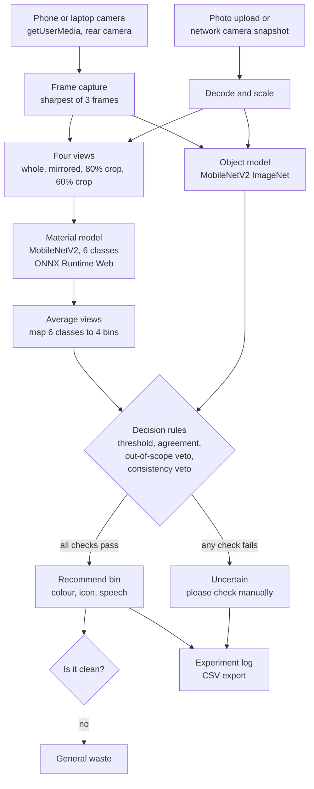

# EcoSort AI: can a pretrained vision model sort everyday waste into the right bin?

## 1. Abstract

Sorting waste correctly at the bin is a small decision repeated billions of times, and
mistakes contaminate recycling. EcoSort AI is a web app that uses a phone camera and two
pretrained neural networks, running entirely on the device, to recommend one of four bins:
general waste, plastic recycling, paper recycling, or other recyclables. No model was
trained for this project. The material model was tested on 700 held-out pictures from a
dataset it was not trained on. Forced to answer every time, it chose the right bin for
{{forced}} of items, which is too error-prone for unsupervised use. EcoSort therefore adds
selective prediction: it recommends a bin only when four views of the picture agree, the
bin probability is at least 95%, and a second model does not object. With these checks it
recommended a bin for {{answered}} of items and was correct for {{acc}} of those; {{wrong}} of all
items were sent to a wrong bin, and {{oos}} of electronics, medical and scrap items were
correctly held back. The hypothesis is supported for the cases where the system chooses to
answer, at the cost of answering "Uncertain" about half the time. Tests with physical items
and a live phone camera remain to be done.

## 2. Introduction and environmental problem

The World Bank's *What a Waste 2.0* report estimated that the world produced about 2.01
billion tonnes of municipal solid waste in 2016 and projected 3.40 billion tonnes by 2050
(Kaza et al., 2018). Recycling reduces the share that is landfilled or burned, but only if
materials arrive at the recycling plant reasonably clean and correctly separated. A
greasy pizza box in the paper bin or a glass jar in the plastics bin lowers the value of the
whole load.

People standing at a row of bins often do not know where an item goes. A tool that looks at
the item and answers immediately could help, provided it is honest about what it does not
know. A confident wrong answer is worse than no answer, because it sends contamination into
a recycling stream with the user's trust attached.

This project asks whether freely available, already-trained models are good enough for that
job today, and what safety logic is needed around them.

## 3. Research question and hypothesis

**Research question.** Can a pretrained computer vision system accurately classify everyday
waste and recommend appropriate disposal bins?

**Hypothesis.** A computer vision model trained on relevant waste images can classify common
waste objects with measurable accuracy under controlled conditions.

**Testable predictions.**

- H1: In Strict mode, at least 90% of the bins EcoSort recommends are correct.
- H2: Performance degrades when pictures are darker or brighter than normal.

## 4. AI and machine-learning methodology

### 4.1 Models (no training performed)

| Role | Model | Trained on | Output |
|---|---|---|---|
| Material | SmartWaste MobileNetV2 v1.3.1 | TrashNet, RealWaste, a public Garbage Dataset and 101 extra photos (11,314 pictures in total, per its author) | Probabilities for cardboard, glass, metal, paper, plastic, trash |
| Object | MobileNetV2-12 (ONNX Model Zoo) | ImageNet-1k | Probabilities for 1,000 everyday objects |

MobileNetV2 (Sandler et al., 2018) is a convolutional network designed for phones. Both
models are about 10 to 14 MB and run in the browser with ONNX Runtime Web (WebAssembly).
Why these were chosen over YOLO, EfficientNet and Vision Transformer options is recorded in
`MODEL_SELECTION.md`.

### 4.2 Preprocessing

Each picture is resized to 224 x 224 pixels with an antialiased bilinear filter, matching
the material model's training pipeline. The material model receives raw 0-255 RGB values
(its graph normalises internally). The object model receives the standard ImageNet
normalisation.

### 4.3 From six materials to four bins

| Material class | Bin |
|---|---|
| cardboard, paper | Paper recycling |
| plastic | Plastic recycling |
| glass, metal | Other recyclables |
| trash | General waste |

Probabilities of classes that share a bin are added. Confusing paper with cardboard, the
model's most common error, therefore does not change the recommendation.

### 4.4 Selective prediction

A classifier's softmax output always sums to 100%, even for objects unlike anything it was
trained on, and modern networks are often over-confident (Guo et al., 2017). EcoSort uses
selective classification (Geifman and El-Yaniv, 2017): it abstains unless all of these hold.

1. **Multi-view agreement.** The picture is analysed four ways: whole, mirrored, and centre
   crops covering 80% and 60% of each side. All four must pick the same bin.
2. **Confidence threshold.** The bin probability, averaged over the four views, must be at
   least 0.95 (Strict) or 0.80 (Balanced).
3. **Out-of-scope veto.** If the object model puts at least half of its probability on
   electronics, medical items, food or clothing, no bin is recommended.
4. **Consistency veto.** If the object model confidently names an object whose usual
   material contradicts the material model, no bin is recommended.

Contamination cannot be judged reliably from a picture, so after a recycling recommendation
the app asks the user whether the item is clean and redirects dirty items to general waste.

Thresholds were chosen on a calibration set and then measured on separate held-out pictures
(Section 6).

## 5. System architecture

Everything runs in the browser. There is no server and no picture is uploaded. The same
TypeScript modules (`src/core`) are used by the app and by the evaluation script.

## 6. Experimental procedure

Full details and blank recording tables are in `EXPERIMENT.md`.

**Part A - picture test set (completed).**

- 1,400 pictures were drawn at random (fixed seed) from TrashBox (Kumsetty et al., 2022),
  200 from each of its seven class folders. TrashBox is not a training source of the
  material model.
- The pictures were split at random into a calibration half and a held-out half of 700 each.
- Thresholds were chosen using the calibration half only.
- The held-out half was then analysed by the app's own pipeline.
- Ground truth: electronics, medical items and construction scrap are "out of scope" (the
  correct answer is Uncertain). Tetra Pak cartons, paper cups, plastic cups and plastic bags
  were not scored because their acceptance varies between recycling schemes.
- Lighting was simulated by multiplying pixel values by 0.3, 0.6 and 1.5.

**Part B - physical items with a phone (not yet done).** Thirty or more real items scanned
under changed lighting, angle, distance and background, recorded with the app's built-in
experiment log.

## 7. Results

All figures below are measured. They are copied from `RESULTS.md`, which is generated
directly from the raw output files.

### 7.1 Held-out pictures ({{n}} pictures: {{nin}} in scope, {{nout}} out of scope, {{ndep}} not scored)

| Measure | Result |
|---|---:|
| Right bin, material model alone, always answering | {{forced}} |
| Right material class (six classes), always answering | {{forced6}} |
| **Strict mode:** gave a bin | {{answered}} |
| **Strict mode:** correct when it gave a bin | {{acc}} |
| **Strict mode:** wrong bin, share of all in-scope items | {{wrong}} |
| **Strict mode:** out-of-scope items correctly held back | {{oos}} |
| Balanced mode: gave a bin | {{b_answered}} |
| Balanced mode: correct when it gave a bin | {{b_acc}} |
| Balanced mode: wrong bin, share of all in-scope items | {{b_wrong}} |
| Mean analysis time per picture (laptop-class CPU, one thread) | {{ms}} ms |

Per-bin precision and recall, the confusion matrix and the list of wrong recommendations
are in `RESULTS.md`.

### 7.2 Simulated lighting (Strict mode, held-out pictures)

| Brightness factor | Gave a bin | Correct when it gave a bin | Right bin without checks |
|---:|---:|---:|---:|
{{brightness_rows}}

### 7.3 Comparison with the author's reported accuracy

The model's author reports {{author}} accuracy on a test split drawn from the training
datasets. On independent pictures the six-class accuracy measured here was {{forced6}}.
A drop of this kind is expected when test pictures come from a different source than the
training pictures, and it is the main reason EcoSort does not trust the top prediction
alone.

### 7.4 Results recording tables for Part B

See `EXPERIMENT.md`, Tables 1 to 6. They are empty because Part B has not been run.

## 8. Accuracy evaluation methodology

- **Answer rate** = recommendations / in-scope items.
- **Accuracy when answered** = correct recommendations / recommendations.
- **Wrong-bin rate** = wrong recommendations / in-scope items. This is the rate of harmful
  outcomes.
- **Precision (bin X)** = correct recommendations of X / all recommendations of X, counting
  out-of-scope items as errors.
- **Recall (bin X)** = correct recommendations of X / items that belong in X.
- **Confusion matrix** with an extra "Uncertain" column.
- **Out-of-scope hold-back rate** = out-of-scope items answered Uncertain / out-of-scope items.
- **Inference time** measured per picture around the full five-pass analysis.

Thresholds were never tuned on the held-out pictures. The evaluation is reproducible with
two commands (README, "Reproduce the measurements").

## 9. Limitations and potential improvements

**Limitations**

- The measured pictures are web photos. Live camera performance on a phone is unmeasured.
- TrashBox and one of the model's training sources are both collections of web photos;
  overlap between them was not checked.
- The lighting test is a digital simulation, not real lighting.
- About half of in-scope items receive "Uncertain" in Strict mode. Safe, but less convenient.
- General waste is the weakest bin: the model rarely recognises it with confidence.
- Some out-of-scope items still received a recycling bin, mostly metal scrap sent to
  "other recyclables".
- Cartons (Tetra Pak) were frequently sent to paper recycling, which is wrong in schemes
  that do not accept them.
- The confidence shown is not calibrated: wrong answers also had high confidence.
- One item at a time. No detection of several items in one picture.
- The material model's repository has no licence file.
- Network camera input was implemented but not tested on a real camera.

**Improvements**

- Run Part B and tune thresholds on photos from the target phone and bins.
- Calibrate confidence with temperature scaling.
- Add an object detector trained on TACO (Proença and Simões, 2020) for multiple items.
- Add classes for organics, textiles, batteries and e-waste.
- Encode a specific municipality's acceptance rules.

## 10. Conclusion

A pretrained MobileNetV2 waste classifier, used as-is, chose the right bin for {{forced}} of
independent test items. That is measurable accuracy, as hypothesised, but not enough for
people to rely on. Wrapping the model in agreement, confidence and veto checks raised the
accuracy of the answers it does give to {{acc}} and cut wrong-bin outcomes to {{wrong}} of
items, by declining to answer about half the time. H1 is supported on the picture test set.
H2 is partly supported: darker and brighter pictures reduced how often the system answered,
while the answers it gave stayed about as accurate. The practical conclusion is that today's
freely available models can assist waste sorting when they are allowed to say "I am not
sure", and that real-world testing with physical items is the necessary next step.

## 11. References

- Deng, J., Dong, W., Socher, R., Li, L.-J., Li, K., and Fei-Fei, L. (2009). ImageNet: A
  large-scale hierarchical image database. *CVPR 2009*.
- Geifman, Y., and El-Yaniv, R. (2017). Selective classification for deep neural networks.
  *Advances in Neural Information Processing Systems 30*.
- Guo, C., Pleiss, G., Sun, Y., and Weinberger, K. Q. (2017). On calibration of modern
  neural networks. *ICML 2017*.
- Kaza, S., Yao, L., Bhada-Tata, P., and Van Woerden, F. (2018). *What a Waste 2.0: A Global
  Snapshot of Solid Waste Management to 2050*. World Bank.
- Kumsetty, N. V., Nekkare, A. B., Kamath, S. S., and Kumar, M. A. (2022). TrashBox: Trash
  detection and classification using quantum transfer learning. *31st Conference of Open
  Innovations Association (FRUCT)*. Dataset: <https://github.com/nikhilvenkatkumsetty/TrashBox>
- Proença, P. F., and Simões, P. (2020). TACO: Trash Annotations in Context for litter
  detection. arXiv:2003.06975.
- Sandler, M., Howard, A., Zhu, M., Zhmoginov, A., and Chen, L.-C. (2018). MobileNetV2:
  Inverted residuals and linear bottlenecks. *CVPR 2018*.
- Single, S., Iranmanesh, S., and Raad, R. (2023). RealWaste: A novel real-life data set for
  landfill waste classification using deep learning. *Information*, 14(12), 633.
- Thung, G., and Yang, M. (2016). Classification of trash for recyclability status. Stanford
  CS229 project report. Dataset: <https://github.com/garythung/trashnet>
- SmartWaste material model: <https://github.com/anniesrdnl/Smart-Waste-Classifier>
- ONNX Model Zoo, MobileNetV2-12: <https://github.com/onnx/models>
- ONNX Runtime Web: <https://onnxruntime.ai>
